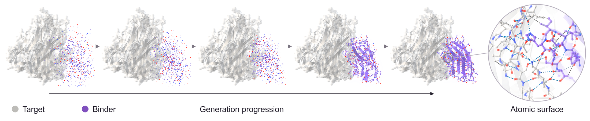
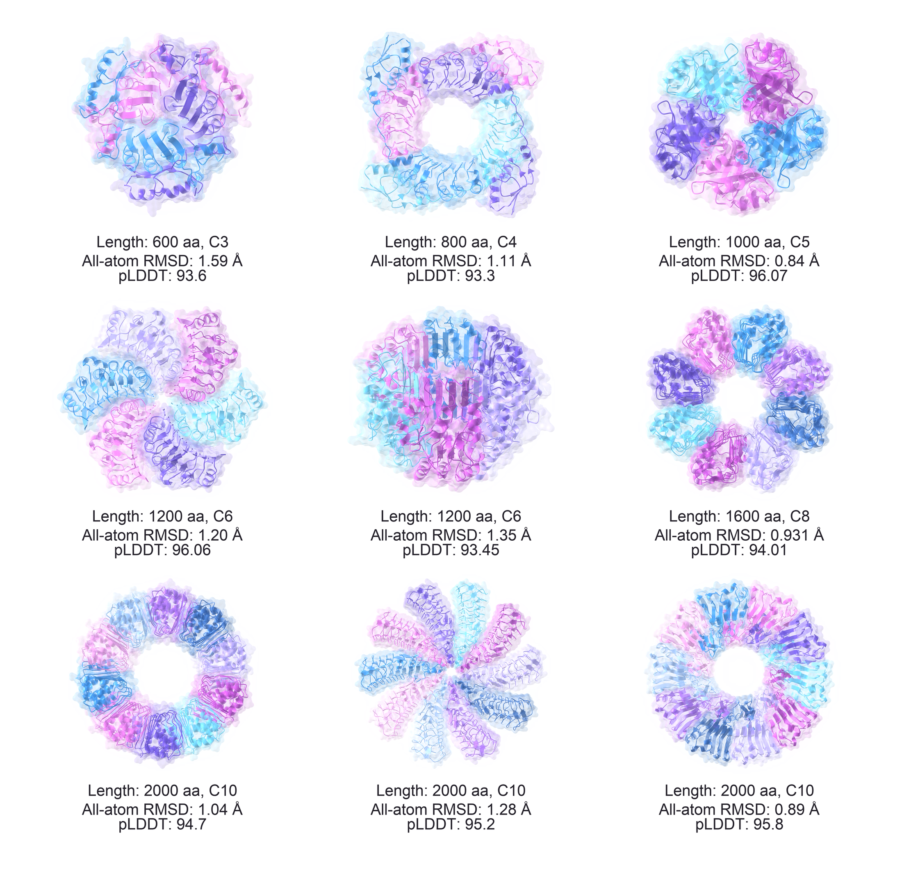
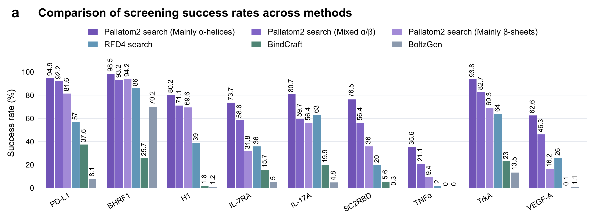
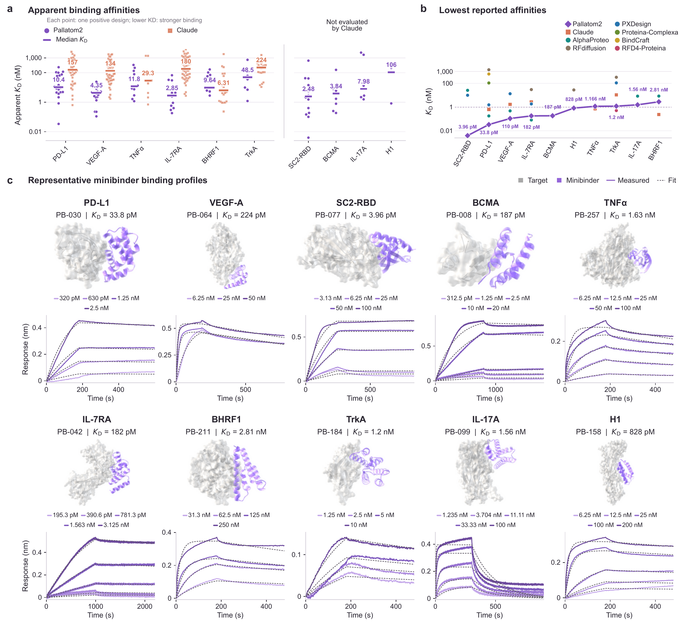

# Pallatom2

**Navigating the *De Novo* Protein Universe with Atom-to-Atom Modeling**

Technical report and accompanying research materials from [Levinthal](https://github.com/levinthal).

[Overview](#overview) · [Highlights](#highlights) · [From modeling to molecular design](#from-modeling-to-molecular-design) · [Report and data](#report-and-data) · [Citation](#citation)

## Overview

Pallatom2 is an **Atom-to-Atom generative model for protein design**. Its central idea is to jointly model protein sequence, backbone conformation, side-chain geometry, and target-interface contacts instead of treating them as disconnected design stages. A unified Atom14 representation and residue-guided sparse all-atom attention coordinate global structure with local atomic detail.

The paper asks how far this atom-level representation can carry a protein design process: from local geometry and whole-protein folds, to target recognition, experimental binding, and new molecular formats.

The work connects broad protein generation with experimentally tested molecular recognition, spanning long-chain proteins, multi-domain architectures, symmetric assemblies, high-affinity binder discovery, interface transfer, affinity maturation, and nanobody rescue.



*All-atom binder generation with a fixed target (report Fig. 1).*

## Highlights

- **Unified atomic modeling.** Sequence, backbone, side chains, and target-interface contacts are modeled in one Atom-to-Atom framework.
- **Generation across scales.** Single-chain sampling extends to **1,600 residues**, with selected homomultimer designs spanning **C3-C10 symmetry** and assembly lengths of **600-2,000 residues**.
- **Leading computational screening.** Helix-rich Pallatom2 sampling achieves the highest reported screening success across all **nine targets** with cross-method data in the report, under the reported protocols.
- **Experimental binding across ten targets.** BLI identifies **112 active designs among 210 tested candidates (53.3%)**, with binders obtained for every target. Six targets yield picomolar-scale apparent affinities, including **3.96 pM for SC2RBD** and **33.8 pM for PD-L1**; TNFα reaches **1.166 nM**.

### Generation across scales



*Symmetric assemblies extend the design space beyond individual protein chains (report Fig. 7).*

### Computational benchmark



*Cross-method computational screening results under the protocols described in the report (Fig. 9a).*

### Experimental binding across ten targets

Across the six shared targets, Pallatom2 achieves lower median apparent K<sub>D</sub> values for **five of six targets** and lower minimum values for **four of six**.

The ten experimentally evaluated targets are BCMA, PD-L1, VEGF-A, SC2RBD, IL-7RA, BHRF1, TNFα, TrkA, IL-17A, and H1.



*Experimental binding across ten targets: (a) apparent affinity distributions; (b) lowest reported affinities; (c) representative predicted complexes and BLI responses (report Fig. 12a-c).*

## From modeling to molecular design

| Application | Main result |
| --- | --- |
| **Structural fast-follow** | Starting-interface-guided BCMA design yields **5 active designs out of 6 tested**. Active designs share only **12.5-37.3% sequence identity** with BC40 while retaining association rates near the starting value; PB-006 reaches an apparent K<sub>D</sub> of **252.1 pM**. |
| **Affinity maturation** | Partial diffusion improves TNFα affinity by up to **7.57-fold**, with **21 active variants among 23 tested**. |
| **Nanobody rescue** | CDR-associated interface remodeling converts an inactive starting nanobody into two active variants with apparent K<sub>D</sub> values of **4.31 and 5.93 nM**. |
| **D-form binder design** | Computational examples target four L-form proteins. Mirror-transformed AF3 predictions agree with the sampled D-form binder backbones at **0.65-0.95 Å backbone RMSD**. |

Experimental affinities are apparent K<sub>D</sub> values measured by biolayer interferometry (BLI). Computational screening results and D-form structural examples are reported separately from experimental binding measurements.

## Report and data

**Technical report:** [Read the full report](./Pallatom2-Technical-Report.pdf).


Supporting experimental materials include BLI plots and disclosed active minibinder sequences. **IL-7RA, BCMA, and nanobody design sequences are not disclosed.** Please refer to the report and its supplementary materials for detailed methods, measurements, and disclosure scope.

## Citation

```bibtex
@techreport{guan2026pallatom2,
  title       = {{Pallatom2}: Navigating the {De Novo} Protein Universe
                 with {Atom-to-Atom} Modeling},
  author      = {Guan, Jiawei and Ma, Rui and Lin, Susu and Wei, Yuting
                 and Jin, Jiaxin and Ye, Wenjun and Liu, Dechuan
                 and Wang, Haobo and Wu, Weikun},
  institution = {Hangzhou Levinthal Biotechnology Co., Ltd.},
  year        = {2026},
  month       = nov,
  url         = {https://github.com/levinthal/Pallatom2-techreport}
}
```

## Contact

For questions about the work, contact [Haobo Wang](mailto:haobowang@levinthal.bio) or [Weikun Wu](mailto:weikun.wu@levinthal.bio).
